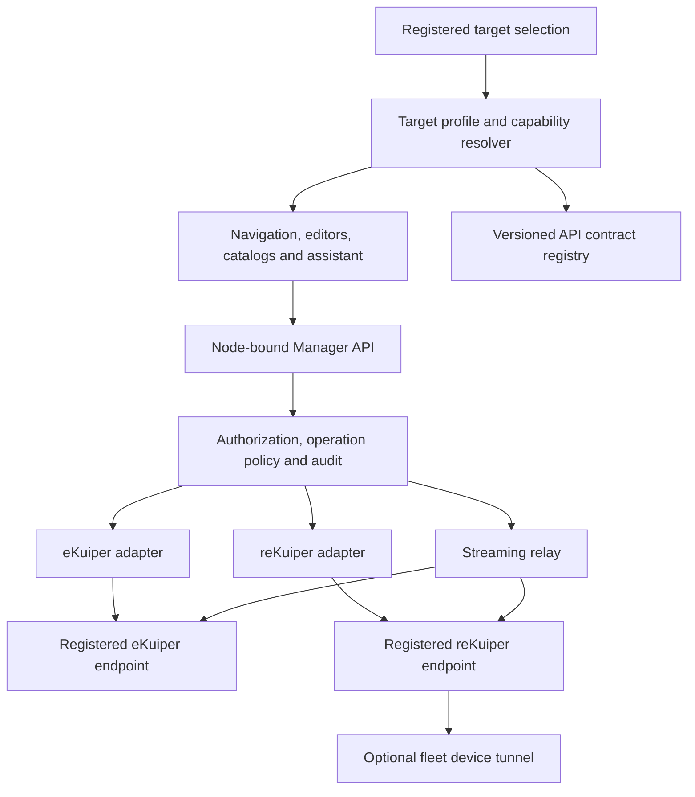

# Engine-aware Manager plan

Status — proposed implementation plan, no runtime changes made  
Research date — 10 November 2026  
Requested outcome — one Manager that adapts to the selected eKuiper or reKuiper target

## 1. Decision and scope

Introduce an engine adapter layer and a target capability profile. Selecting a registered target determines its navigation, forms, compiler, diagnostics, operations, assistant context and API documentation. A node may be a directly registered engine or, in the later fleet phase, a device reached through a registered reKuiper control plane.

Retain the existing Manager shell, authentication, PostgreSQL storage, Flow Studio, revisions and deployment history. Extend those foundations with reKuiper-native workflows. Useful console interaction patterns, including guided setup and schema inference, should also benefit eKuiper where its verified API supports them.

This plan covers the seven current reKuiper console areas and the management APIs behind them. “Complete support” means every audited operation has a recorded disposition — implemented, deliberately engine-internal, unavailable in the tested build, or blocked by a documented upstream dependency. A page or a successful discovery request alone does not establish runtime support.

The implementation scope remains a self-hosted Manager. Fleet management expands the older DEVELOPMENT_PLAN.md scope in a later milestone. Manager account administration remains global, while engine configuration and fleet data remain target-specific.

## 2. Evidence and baseline

| Component | Inspected baseline | Implication |
| --- | --- | --- |
| Manager | Local checkout at `910cdae6e935ec4bde60deaf5d02df7c83123d5b` during the final source check | Existing theme and release work may continue independently. This document introduces no application changes. |
| reKuiper | Main commit `76d605a865b929cc2d9a4cbe0fcbc76c248eb41a`, package version `1.0.0-rc5` | Source-level planning baseline, not a claim that the published rc5 artifact contains every main-branch change. |
| reKuiper release tag | `v1.0.0-rc5` resolves to `ec1673850e65bd033c0592dce477b575633664f0` | Inspected main differs from this tag in metrics, rules, stream handling and rule-test replay. Qualification must pin an actual artifact and commit. |
| eKuiper | Existing audited 2.4.1 contract, with 2.4.2 as the next stable qualification target | Preserve current behavior, then qualify 2.4.2. Keep 2.5 previews in a separate compatibility profile. |
| reKuiper OpenAPI | Root and documentation copies each contain 110 paths and 158 HTTP operations | Both omit registered operations needed by the embedded console. Copying the file alone will not complete Swagger coverage. |
| UI inspection | Current embedded `ui.html`, handler/model source, repository documentation and repository screenshots | The dashboard screenshot shows rc4. Current source determines the feature mapping. No live reKuiper deployment was exercised in this pass. |

Source anchors are listed in section 15. Recommendations below are design proposals unless explicitly described as observed behavior.

## 3. Existing integration gaps

| Observed condition | Required change |
| --- | --- |
| `src/lib/nodes.ts` accepts versions at or above eKuiper 2.4.1 without identifying the engine | Separate engine identity, version compatibility, reachability and authorization. Current reKuiper reports its Cargo version, 1.0.0-rc5, and is classified incompatible by this comparison. |
| The root response has version, OS, architecture and host statistics, but no explicit product or capability descriptor | Introduce a verified discovery strategy and propose an upstream descriptor. Never classify engine family from its major version alone. |
| `resolve-capabilities.ts` intersects metadata with a frozen eKuiper graph catalog | Use separate graph catalogs. reKuiper's `/metadata/operators` lists expression operators such as AND and BETWEEN, while its graph palette is under `/metadata/palette` and `/api/v1/palette`. |
| The Manager graph edge contract is `Record<string, string[]>` | reKuiper also accepts port-indexed `string[][]`. Preserve port numbers, empty ports and branch semantics in its own compiler/importer. |
| The proxy selects a target from a cookie and switching reloads the window | Bind requests, drafts, events and deployment artifacts to an explicit target identity. A cookie shared by tabs cannot be the authority for an already-open editor's mutation. |
| Proxy roots exclude `api`, `comms`, `test`, `declarative`, `v1` and `otlp` | Add audited operations through adapters. Avoid enabling an entire namespace or an unrestricted fleet proxy. |
| The generic fetch proxy uses a 30-second timeout and does not bridge WebSocket upgrades | Add a dedicated streaming path for wire taps and test output with its own lifecycle and limits. |
| Sidebar, client methods, tool descriptions and Swagger are eKuiper-specific | Introduce profile-driven navigation and API selection, with separate engine contracts and feature-aware assistant tools. |

## 4. What the selected engine changes

| Area | eKuiper target | reKuiper target | Planned Manager behavior |
| --- | --- | --- | --- |
| Target identity | eKuiper version and tested compatibility range | reKuiper version, preview status and deployment mode | Persistent node/engine badge. Connection, authentication and compatibility are separate states. |
| Overview | Existing rule and host diagnostics supported by the profile | Pipeline health, throughput, sink retry cache, DLQ stages and connector health | Shared dashboard structure with engine-specific cards. Unavailable values remain unavailable, never fabricated zeroes. |
| Rules | Existing SQL, actions, options and lifecycle contracts | SQL/graph rules, native options, DLQ and tap actions | Shared list and editor shell, separate serializers, validation and action permissions. |
| Guided pipelines | Recipes using available eKuiper sources/functions/sinks | Industrial and simulator recipes using qualified native capabilities | Source → transformation → destination → review. Show generated resources and target before deployment. |
| Streams and tables | Existing eKuiper DDL and metadata | Industrial sources, simulator, schema/data endpoints and native connector options | Sample-JSON inference, typed fields, dependency-aware connection selection and target-specific DDL preview. |
| Connections and formats | Version/build-dependent installed drivers | Native catalogs and connection properties | Merge verified build support with metadata. Treat connector advertisements as candidate capabilities until qualified. |
| SQL functions | Engine metadata plus a versioned fallback | Native metadata including registered UDF/service functions | Actual editor completion and function browser consume the selected catalog. Do not only update the currently unused static functions file. |
| Flow Studio | Existing eKuiper graph compiler | Port-aware graph compiler, switch router, rate limiter, watchdog and qualified native operators | One canvas and property framework with separate node registries, importers and output contracts. |
| Runtime inspection | Existing bounded snapshots and supported traces | Wire taps over `/comms`, connector events and dropped-sample counters | Inspection drawer shows samples separately from full throughput metrics. |
| Rule testing | Current separate-port transport remains gated until qualified | SQL simulation plus `GET /test/{name}` on the main REST router in inspected source | Target-bound test sessions and same-origin streaming relay. SQL simulation and full graph execution have separate capabilities. |
| DLQ | Existing error/status tools where supported | `/rules/{name}/errors` and `/dlq` aliases expose stage counts and recent payloads | Inspect/filter/export available records and explicitly clear errors. No replay button until a replay operation is proven. |
| Ingestion laboratory | Supported HTTP push or test APIs | OTLP metrics/logs/traces, stream/table injection and simulator | Target and resource selector, payload templates, response and resulting output. Clearly label sends to live pipelines. |
| Extensions | Existing eKuiper plugin/script/service contracts | Native plugin, Wasm and JavaScript UDF APIs | Runtime-specific package constraints, lifecycle and validation. Portable-plugin mutation is unavailable in the inspected reKuiper source. |
| Files and schemas | eKuiper upload/schema semantics | TLS, protobuf and other supported engine artifacts | Return node-side artifact references and preserve source-node ownership. Do not interpret an engine path as a browser file path. |
| Declarative operation | Existing eKuiper semantics | Manifest-controlled resources, reload and export | Mode badge and operation-level action gating. Retain inspection and only operations permitted by the actual mode. |
| Fleet | Manager's registered engine list | Device groups, snapshots, staged rollouts, remote inspection, fleet health/DLQ/audit | A separate Fleet area associated with a reKuiper control plane. Preserve Manager Nodes as the connection registry. |
| Backup and migration | eKuiper export/import formats | Compatibility exports plus declarative manifests | Export format/version labels, secret handling, dependency preflight and explicit target compatibility report. |
| Assistant | eKuiper context and approved tools | reKuiper catalog, graph semantics and authorized fleet/diagnostic reads | Tool availability and prompts follow the selected target. Keep existing review-before-apply behavior. |
| API reference | Pinned eKuiper spec/version | Pinned reKuiper spec plus audited additions | Automatic selected-target view and explicit offline reference selector. “Try it” uses the registered target through Manager authorization. |

### UI patterns to adopt

- Keep the Manager's responsive sidebar, light/dark themes and accessibility conventions. Add a clear engine badge and contextual actions.
- Adopt the console's guided source/goal/destination workflow, recipes, stream-field chips, window explanations, schema inference and inline documentation.
- Combine rule overview, topology, test output and error inspection in a consistent detail workspace.
- Put advanced resilience options behind progressive disclosure, with descriptions appropriate to the engine. MQTT QoS or a selectable QoS field must not imply a universal end-to-end delivery guarantee.
- In reKuiper mode, show Operations entries for Diagnostics, Data Test, Declarative and Fleet only when their capabilities are known.
- If a bookmark targets an unsupported feature, show the selected target and reason, with navigation back to an available page. Do not silently run an approximate operation.

## 5. Proposed architecture

### Target and profile data

Extend the server-side node registry with engine selection preference `auto | ekuiper | rekuiper`, detected family, raw runtime version, compatibility profile identifier, profile revision, evidence timestamp and an encrypted credential configuration. Keep configured preference separate from detected identity.

A target reference consists of a registered node ID and, for remote fleet operation, a device ID under that control plane. It never contains a client-supplied URL. Treat the direct control plane and its devices as different targets with independent capabilities and cache identities.

The normalized profile should include the following fields.

| Field | Purpose |
| --- | --- |
| `engine.family`, `runtimeVersion`, `profileId` | Identify the selected engine and the exact tested contract. |
| `identitySource`, `checkedAt`, `profileRevision` | Explain discovery and invalidate stale assumptions after upgrades or configuration changes. |
| `connectionState`, `authorizationState` | Distinguish offline, reachable, authentication required and forbidden responses. |
| `operationMode` | Imperative, declarative or unknown. Do not infer this from an arbitrary 403. |
| `deploymentRole` | Standalone, fleet control plane, fleet device or unknown, based on reliable evidence/configuration. |
| `capabilities` | Per-feature status, reason, provenance and tested version range. |
| `catalogs` | Sources, sinks, formats, functions, graph operators and property/port schemas. |
| `contracts` | Spec identifier, graph dialect, auth scheme and transport variants. |

Capability states should distinguish supported, unsupported, unknown and temporarily unavailable. User permission and deployment-mode restrictions are separate dimensions. A read-only user or a declarative deployment does not make a supported feature disappear from the engine's technical capabilities.

Examples of capability keys include `rules.sql`, `rules.graph`, `rules.bulkControl`, `graph.multiPort`, `graph.watchdog`, `diagnostics.wireTap`, `diagnostics.dlqRead`, `diagnostics.dlqClear`, `test.sqlSse`, `test.graph`, `extensions.wasm`, `extensions.javascript`, `declarative.reload` and `fleet.rollouts`.

### Detection procedure

1. Fetch the root information through the registered destination policy. Probe a bounded authenticated read to distinguish public-root reachability from usable credentials.
2. Prefer an explicit engine descriptor if a future tested build provides one.
3. For existing reKuiper builds, combine known, validated response signatures such as the palette schema and UI auth-status schema with the pinned compatibility profile. Use only bounded read requests. A version string, HTML page or generic 200 response is insufficient.
4. Allow an administrator to select the intended engine when auto detection remains ambiguous. Record it as configured identity, continue contract validation and show contradictory evidence.
5. Use runtime metadata to narrow or qualify catalogs. The inspected palette and source/sink listings are largely static definitions, so their presence alone does not prove every connector executes successfully.
6. Cache discovery with a proposed 60-second freshness interval, deduplicate concurrent probes and recheck before consequential operations after expiry. Reprobe immediately on credential changes, upgrades or explicit refresh.
7. Preserve the last successful profile for offline inspection, visibly mark it stale and block dependent live mutations.

Propose an additive reKuiper discovery endpoint or root extension containing product, runtime/build version, declarative mode, role, available connector runtimes and operation capabilities. This is an upstream dependency for fully reliable automatic mode discovery, not an existing endpoint.

When a release tag and a later main build report the same runtime version, use their verified common capability subset unless the deployed artifact is independently pinned in node configuration. Version equality does not prove identical replay, metrics or validation behavior.

For legacy declarative nodes, use an administrator-declared mode and handle the specific `declarative_mode_active` response. Never send a mutation just to discover mode. Where mode is unknown, show that state and gate mode-sensitive operations until it is resolved.

### Adapter boundary

Create `src/lib/engines/` with a contract registry, discovery/profile resolver and eKuiper/reKuiper adapters. Adapters own wire DTOs, error translation, validation, payload serialization, endpoint/auth mapping and supported transports. Shared components consume normalized models without importing Rust- or Go-specific wire types.

Keep the current eKuiper client behind its adapter initially. Introduce `/api/nodes/{nodeId}/engine/...` routes with audited operation mappings, and dedicated events/test routes. Migrate all mutation callers before relying on the cookie-based route as a compatibility shim.

All routes enforce the current Manager session and node access policy. A capability flag only describes engine support. It does not grant permission. Classify operations by side effect, including upstream `GET /stop`, instead of assuming all GET requests are harmless.

## 6. Switching semantics

Switching changes the UI context. It does not migrate, deploy or convert resources.

1. Capture the old target and editor state. Save a draft under its original target, or present explicit save/discard/cancel choices for unsaved changes.
2. Resolve the destination profile before enabling target-specific controls. If it is offline, offer an explicitly offline view.
3. Stop polling and streaming subscriptions for the old target. Cancel outstanding reads and reject late responses by target and profile revision.
4. Keep any already-issued mutation bound to its original target. Cancellation in the browser cannot establish whether the engine completed it. Reconcile its result on that original target.
5. Switch route context and select cache keys containing target identity, engine contract/profile revision and resource.
6. Rebuild catalogs, forms, documentation and assistant context. Unsupported routes get an explanation.
7. Resume subscriptions for the new target. Restore that target's drafts without altering the previous target's document.

The selection cookie may remain a landing-page preference. Explicit target identity is authoritative for reads, writes, exports, stream subscriptions and assistant tools in an open workspace. Two browser tabs must be able to operate on different engines safely.

A changed target configuration or profile causes stale mutation requests to fail with a distinct conflict response, followed by review/revalidation. Audit records capture user, direct target, optional fleet device, engine version, operation and outcome.

## 7. Flow Studio and rule authoring

Use the existing FlowDocument, canvas, revision and deployment systems. Add an explicit engine dialect and schema version to semantic documents and compiled artifacts, with an additive migration for existing eKuiper documents.

Create a reKuiper registry and compiler under `src/lib/flows/compiler/rekuiper/`. Keep graph properties, node IDs and port routing lossless. In particular, an empty port 0 followed by connected port 1 must remain distinct from a connection on port 0.

Store layout in the Manager, as today. Preserve unrecognized native properties in an opaque round-trip representation and mark unsupported nodes read-only. Do not silently drop data when importing a newer engine's rule.

Compile deterministically from document, engine profile, compiler version and extension versions. Record those inputs and the exact deployed native payload with deployment history. Hash engine-specific semantics as part of the document's semantic identity.

Provide three clear authoring paths.

- Guided designer for verified recipes and common transformations.
- Flow canvas for supported native graph operators and visual inspection.
- Native SQL/JSON editor for complete contract access, with server-side validation and a compatibility explanation when graphical editing is incomplete.

A deliberate “Copy to another engine” workflow generates a compatibility report, maps only verified equivalents and creates a separate draft. It must block unsupported port semantics, operators, functions, option values and connector formats. No conversion occurs merely by selecting another target.

The native reKuiper validation endpoint is required but not sufficient to establish runtime semantics. Qualify switch branches, watchdog timing, rate limiting, windows, joins and sink output using real sample data on the pinned engine.

Guided deployment is a staged workflow with dependency checks, resource preview and a recorded outcome for each created resource. On partial failure, report what exists and offer explicit cleanup/retry. The current reKuiper console quick-start button opens a prefilled rule designer; its implementation does not substantiate the documentation's single-transaction provisioning claim.

## 8. Streaming, diagnostics and testing

### Wire taps

Use a server-side WebSocket client to reKuiper's registered `/comms` endpoint. Deliver filtered events to the browser over a dedicated authenticated SSE route. Tap enable/disable remains an ordinary audited operation. This avoids requiring browser-held upstream credentials or general-purpose WebSocket proxying.

The relay must enforce authorization on connection and periodic session checks, filter by authorized target/rule, limit buffer sizes, propagate disconnects and report dropped samples. The upstream bus publishes more than one rule's events, so browser-side filtering alone is insufficient.

Manage tap ownership across Manager viewers. Upstream taps are global per rule/node rather than per browser session. Use reference-counted Manager leases, do not disable a tap that was already enabled externally, and document the remaining ownership race until upstream provides scoped leases. On disconnect, release only Manager-owned taps under that policy.

Treat tuple samples as inspection samples. Use actual counters and elapsed time for throughput. Account for resets, node restarts, unknown values and different metric names/units.

### SQL trial runs

The inspected reKuiper router exposes `GET /test/{name}` on its main REST listener even though session creation also returns `httpServerPort`. Prefer the proven registered-origin route, with no trust in an arbitrary returned host/port. Retain eKuiper's transport restriction until its separate-port policy and relay are independently qualified.

Model create, subscribe, start, stop/delete and expiry explicitly. Assign session ownership and avoid duplicate start/retry execution. Verify replay behavior against the exact build. Graph testing remains a separate capability because the inspected create payload is SQL and mock-source based.

In declarative mode, the inspected guard allows POST rule-test requests but does not generally allow their DELETE cleanup. Disable Manager-managed trials in that mode until lifecycle cleanup is proven or upstream corrects the operation policy.

### Diagnostics and test console

Add DLQ views for codec, schema, SQL, template and sink failures, with retained-payload limits and explicit clearing. The current API exposes recent errors and counters, not a verified message-replay operation.

Add OTLP and stream/table payload templates. Sending a payload is a data-plane mutation and may trigger real sinks. Keep its target and effects visible in the send review.

Use a dedicated streaming timeout/heartbeat policy. Do not apply the generic 30-second request timeout to long-lived streams. Bound per-user sessions, buffered events and maximum duration, and test the production reverse proxy for buffering and disconnect behavior.

## 9. Extensions, declarative mode and fleet

### Extensions

Reconcile plugin manifests, Wasm bytecode/file inputs, JavaScript UDF records, external services and artifacts through their engine adapters. Verify package format, runtime support, restart requirements and durability on restart rather than inferring these from a shared endpoint name.

For UDF testing, distinguish a browser preview from execution in the engine's runtime. The current console uses `new Function` in the page. Do not reuse that as a security boundary or as proof of engine-equivalent behavior. Prefer an isolated engine test capability, or explicitly label and isolate a limited preview if no such capability exists.

Portable-plugin create/update/delete return 501 in the inspected reKuiper source. Represent this as unsupported with a reason. Do not inherit eKuiper's installation workflow for that target.

### Declarative operation

Display manifest ownership and a reliable mode indicator. Gate each operation using the audited mode policy rather than globally disabling every control.

The current reKuiper guard allows selected ingestion, fleet, reload and error-clear operations while blocking many resource/lifecycle mutations. `POST /rules/validate` and tap operations are also affected by this guard. This requires explicit tests and possibly upstream policy changes before Manager exposes those workflows in declarative mode.

Reload should show target, last known reload outcome and failure details. Imported/exported manifests need schema validation, dependency ordering and secret handling. An engine-local manifest path is not a repository integration. Editing Git repositories and opening PRs would be a separate future integration.

### Fleet

Keep reKuiper as the owner of device connections, snapshots, rollout state and health decisions. Manager presents those contracts and stores its own user/action audit context.

Deliver in this order.

1. Read-only devices, groups, heartbeat freshness, health, fleet metrics, DLQ and audit.
2. Remote inspection through the selected registered hub and explicit device ID.
3. Immutable snapshot creation/viewing and artifact verification.
4. Rollout creation, stage/status visibility, promotion and rollback with affected devices and engine response visible.

Do not assume the configured role from an empty devices response. The fleet routes are mounted in the inspected router regardless of whether a meaningful fleet is configured.

Model device identity as hub plus device ID. Detect duplicate direct/tunneled connections without merging their authorization. Validate remote device capabilities independently from the hub. Restrict allowed downstream operations through the existing destination policy and avoid nested arbitrary proxy paths.

The engine-to-engine `/fleet/ws` protocol remains between reKuiper devices and their control plane. Manager does not need to implement the agent protocol to offer fleet management.

## 10. Swagger and contract work

Maintain separate engine contracts and a small Manager-owned contract for discovery/target/relay APIs. Do not merge both engines into a single superset that implies unavailable operations exist.

Proposed layout.

- `public/openapi/ekuiper/2.4.1.json`
- `public/openapi/ekuiper/2.4.2.json` after qualification
- `public/openapi/rekuiper/<qualified-version>.json`
- A checked manifest recording engine, runtime version, source commit, checksum, feature requirements and validation status
- Compatibility aliases for current documentation links

Change `scripts/validate-openapi.mjs` to validate per-engine profiles while retaining its route, provenance, reference and operation-ID checks. Generate the public and docs-site copies from one canonical source.

The first reKuiper audit must cover the following omissions found in literal route registration after normalizing path-parameter names.

| Missing group | Operations to document and qualify |
| --- | --- |
| Discovery/auth | GET `/version`, GET `/api/ui/auth-status`, POST `/api/ui/login` |
| Graph palette | GET `/metadata/palette` and `/api/v1/palette` |
| Rule diagnostics | GET `/rules/{id}/cpu`, GET `/rules/{name}/scantables` |
| Taps and live events | POST enable/disable and GET status under `/rules/{id}/tap/{node_id}`, GET `/comms` WebSocket |
| Trial output | GET `/test/{name}` SSE |
| Metrics/OTLP aliases | GET `/metrics`, POST `/otlp/v1/metrics`, `/otlp/v1/logs`, `/otlp/v1/traces` |
| Export variants | POST `/v2/data/export`, GET `/ruleset/export` |
| Plugin variants | POST `/plugins/udfs`, DELETE `/plugins/udfs/{name}` |
| Configuration variants | GET and POST confKey operations for sources, sinks and connections |
| Fleet | Device/group/snapshot/rollout CRUD and actions, remote proxy, fleet metrics/DLQ/audit, and the separate agent WebSocket handshake |

Record aliases once in the coverage ledger while preserving actual documented routes. Do not treat `ANY` proxy registration as proof every downstream method is supported. Document the Manager's explicit remote-operation subset.

Audit fallback dispatch and configured HTTP-push endpoints separately from literal route declarations. The static route comparison performed for this plan does not establish coverage of those dynamic paths.

OpenAPI must represent HTTP request/response/error behavior. Document WebSocket event schemas, heartbeat/close semantics and SSE session lifecycle in a companion event contract, with AsyncAPI if useful. OpenAPI alone does not specify an established WebSocket session.

Add provenance and capability annotations such as `x-engine-family`, `x-source-commit`, `x-required-capabilities` and `x-deployment-modes`. Capture raw JWT versus password/fleet-token authorization behavior. reKuiper's inspected JWT middleware requires a raw token, while its shared-token modes accept a bearer form.

Swagger selection follows the current target profile. An offline engine/version selector is also available. Interactive calls use the authorized Manager route, show the target, preserve operation restrictions and never expose upstream credentials in the browser. Protect mutable operations even when an upstream route uses GET.

### Carry forward the eKuiper update work

- Qualify 2.4.2 first. Its management surface remains 98 paths and 140 operations from the preceding upstream audit.
- Add new SQL-function support to the catalogs actually used by editors and help, with engine/version requirements.
- Keep 2.5 previews separately labeled. Add `scantables` only in profiles that support it.
- Track JSONL, Kafka metadata/offset settings, buffer policy changes, service restart behavior and checkpoint compatibility separately from endpoint counts.
- Include a real-output test for Flow Studio's saved-stream `sourceName` path. The earlier audit identified the relevant fix in 2.5 rather than the inspected 2.4 branches.
- Show an upgrade compatibility report before moving between engine families or versions. Checkpoint and binary plugin compatibility require explicit verification.

## 11. Implementation sequence

Each item is intended as a reviewable PR or a small series. No delivery dates are asserted before fixture/qualification work establishes scope.

| ID | Deliverable | Depends on | Acceptance |
| --- | --- | --- | --- |
| EA-01 | Pinned source/build matrix and operation coverage ledger | None | Every current reKuiper console/API family has evidence, a Manager disposition and a fixture requirement. Stable tags are distinguished from main. |
| EA-02 | Separate specs, provenance manifest and multi-engine validator | EA-01 | All known HTTP operations classified, event protocols documented separately, public/docs copies identical. |
| EA-03 | Engine identity/profile resolver and additive database migration | EA-01 | eKuiper 2.4.1/2.4.2 and qualified reKuiper identify independently. Ambiguous, offline, auth-failed and unknown-mode states have tested behavior. |
| EA-04 | Explicit-target routes, adapters and operation policy | EA-02, EA-03 | No client-supplied destination URL. Auth schemes correct. Writes cannot be redirected by another tab's cookie change. |
| EA-05 | Switching coordinator, scoped caches/drafts and navigation | EA-04 | Dirty edits survive switching. Late responses do not leak across targets. Unsupported deep links and profile changes are handled. |
| EA-06 | Shared resource workflows and dynamic catalogs | EA-05 | Stream/table/connection/schema/rule workflows pass on both engines. Function completion and connector forms use the active profile. |
| EA-07 | Guided pipeline and schema authoring | EA-06 | All generated resources previewed and validated. Partial deployment reports are accurate. Recipes are capability-filtered. |
| EA-08 | Native reKuiper graph importer/compiler and properties | EA-06 | Multi-port round-trip and real-output tests pass, including empty ports, switch defaults, limiter and watchdog semantics. |
| EA-09 | Streaming relay, tap leases and SQL trial-run lifecycle | EA-04, EA-08 | Auth, filtering, bounded buffering, disconnect cleanup and target switching pass against the production deployment path. |
| EA-10 | DLQ, enriched metrics and ingestion laboratory | EA-06, EA-09 | Stage errors displayed correctly, clearing audited, test input routed to the intended target, samples distinguished from metrics. |
| EA-11 | Engine-specific extensions and artifact handling | EA-06 | Supported Wasm/JS/native workflows qualified, runtime persistence checked, unsupported portable operations explained. |
| EA-12 | Declarative workflows and reliable mode discovery | EA-03, EA-06 | Mode never inferred from reload-failure metric presence. Blocked operations and permitted exceptions behave correctly, including test cleanup. |
| EA-13 | Fleet read paths, then remote control and rollouts | EA-04, EA-10, EA-12 | Hub/device identity preserved, snapshots verified, staged promotion/rollback and offline-device results accurately represented. |
| EA-14 | Engine-aware assistant, help and interactive Swagger | EA-02, EA-05 and relevant feature PRs | Tools and docs match target capabilities. Switching invalidates stale tool context. Secrets stay server-side. |
| EA-15 | Deployment profiles, migration/rollback documentation and release qualification | Relevant preceding items | Reproducible pinned builds, full journey matrix green, no unclassified operations advertised as supported. |

Release milestones are deliberately separable.

- Foundation — EA-01 through EA-06, plus the applicable EA-14 work. Engine selection is reliable and common operations work on both engines.
- Native reKuiper experience — EA-07 through EA-12. Advanced authoring, inspection and operation are available for the qualified build.
- Fleet experience — EA-13, with explicit device and rollout semantics.
- Qualified release — EA-15 for the published milestone scope. Remaining unsupported operations are visible in its support matrix.

## 12. Files and subsystems affected later

| Existing area | Planned responsibility |
| --- | --- |
| `src/lib/nodes.ts`, `src/lib/nodes/diagnostics.ts`, `database/migrations/` | Discovery, profile persistence and status separation |
| `src/stores/server-store.ts`, `src/components/providers.tsx` | Explicit target context, switching and cache lifecycle |
| `src/components/layout/sidebar.tsx` and header | Profile-aware navigation, node/engine/mode indicators |
| `src/app/api/ekuiper/[[...path]]/route.ts`, `src/lib/network.ts` | Adapter-backed operation routing, target binding and destination policy |
| `src/lib/ekuiper/client.ts` and existing catalogs | Retain eKuiper wire behavior behind the new adapter |
| New `src/lib/engines/` and node-bound API routes | Common contracts, eKuiper/reKuiper implementations and profile registry |
| `src/lib/flows/capabilities/`, `model/`, `compiler/` | Engine dialect, catalog resolution and native graph serialization |
| `src/lib/flows/persistence/`, `deployments/`, `runtime/` | Target/profile/compiler provenance, draft migration and native metrics mapping |
| `src/lib/assistant/` | Engine-aware tools, guidance and target binding |
| `public/api-docs/index.html`, OpenAPI files and `scripts/validate-openapi.mjs` | Versioned references and audited route coverage |
| Docker/Compose and CI files | Separate pinned engine fixtures and release qualification, coordinated with existing release work |

Migration should be additive. Existing node records begin with auto detection and unknown identity until probed. Existing Flow documents retain their established eKuiper dialect. Preserve old artifacts as historical records and never reinterpret their payloads under the newly selected engine.

## 13. Acceptance and qualification matrix

| Scenario | Required result |
| --- | --- |
| eKuiper → reKuiper → eKuiper | Correct navigation/catalogs/forms/docs restored without stale data or draft loss |
| Two tabs on different engines | Every request and mutation reaches the tab's explicit target |
| Slow old-target response after switch | Result discarded from the new workspace |
| Mutation in flight during switch | Original target retained, outcome reconciled there, no automatic replay |
| Engine upgraded at the same URL | Profile revised, stale compiled/deploy requests rejected pending validation |
| Unauthenticated root succeeds but resource API returns 401 | Reachable/auth-required state, no false ready status |
| Unknown engine or malformed metadata | Bounded fallback behavior and explanatory status, no optimistic capability grant |
| Declarative reKuiper | Exact operation matrix honored, including validation, taps and test-session cleanup restrictions |
| Multi-port graph import/export/deploy | Port order, gaps, properties and behavior preserved |
| Unsupported native node/function/format | Retained in draft with diagnostics, blocked from incompatible deployment |
| Tap bus emits another rule's data | Server relay filters it before delivery to unauthorized contexts |
| Disconnect, logout or node switch | Streaming resources released according to ownership policy |
| Browser preview versus engine UDF execution | Clearly distinguished, actual runtime result used for engine qualification |
| Portable-plugin operation on current reKuiper | Disabled with explicit unsupported status |
| DLQ sample/clear | Accurate stage/payload display and bounded explicit clear behavior |
| Fleet hub/device versions differ | Separate profiles, correct device routing and compatibility result |
| Canary fails or a device disconnects | Engine-reported rollout outcome retained, no invented success or automatic promotion |
| Import across engine families | Dependency and compatibility report before applying |
| Fresh database and upgrade from existing Manager | Preserved nodes, credentials, drafts, revisions and deployment history |
| Spec drift | CI identifies missing operations or stale schema/provenance, with every exception reviewed |
| Mobile, keyboard and both themes | New workflows meet the same navigation, focus and contrast expectations as existing pages |

Fixtures should cover current eKuiper 2.4.1, next stable 2.4.2, the qualified reKuiper artifact in imperative and declarative modes, authenticated variants and a hub/device pair. Add a separate optional eKuiper preview lane.

Unit tests target serializers, profile resolution, target transitions and graph semantics. Contract tests target real request/response behavior. Integration/E2E tests target observable workflows and real rule output. Source-route enumeration complements runtime tests but does not replace them.

## 14. Reliability, trade-offs and upstream requests

Proposed initial operating budgets are engineering acceptance targets, not measured capacity.

- Cache discovery for 60 seconds and deduplicate probes per registered target.
- Default visible diagnostic polling to one request cycle every two seconds, pausing hidden views.
- Bound an inspection view to 500 retained samples and clearly display drops.
- Start with at most five active tap views per user, subject to qualification and engine limits.
- Avoid continuously polling every device in a fleet. Use fleet aggregate endpoints and fetch device detail on demand.
- Test a 1,000-device catalog fixture and a 500-node graph fixture before committing performance claims.
- Use bounded exponential backoff for transient read/stream failures. Never blindly retry deploy, import, rollout promotion or other non-idempotent mutations.
- Surface engine errors and partial outcomes. A Manager restart must not imply rollback of an operation already accepted by an engine.

Revisit stream fan-out and tap leases before multiple Manager replicas are supported. A single-process reference count is insufficient for shared ownership. PostgreSQL-backed leases or an upstream session-scoped subscription protocol will be required.

| Decision | Benefit | Cost or constraint |
| --- | --- | --- |
| Shared shell with engine adapters | Consistent management experience and independent contracts | Adds DTO mapping and capability plumbing |
| Separate graph dialects | Preserves native semantics | Cross-engine conversion requires explicit mapping |
| Manager WebSocket-to-SSE relay | Keeps upstream credentials server-side and fits browser consumption | Requires bounded long-lived server resources and lifecycle testing |
| Native fleet control plane as authority | Avoids duplicating rollout/tunnel implementation | Manager must expose upstream limits and partial results accurately |
| Runtime discovery plus pinned profiles | Handles version/build differences | Metadata is incomplete today, requiring conservative fallback and upstream improvements |
| Versioned specs and route audit | Makes coverage reviewable | Ongoing maintenance per engine release |

Upstream requests to prepare after the Manager contract work is concrete.

1. Add explicit product/build/capability/mode discovery.
2. Complete OpenAPI coverage and publish event protocol schemas.
3. Expose declarative-mode operation permissions consistently, including validation, taps and test cleanup.
4. Add session-scoped taps/subscriptions or leases to eliminate cross-client ownership ambiguity.
5. Provide an isolated engine-side UDF testing contract if that workflow is intended to be supported.
6. Clarify connector/runtime availability separately from static palette metadata.

These are proposed contributions. No upstream issue, comment or PR has been posted by this planning pass.

## 15. Source references

All reKuiper code links below are pinned to the inspected main commit.

- [Repository and runtime version](https://github.com/Indus-Stack/rekuiper/blob/76d605a865b929cc2d9a4cbe0fcbc76c248eb41a/Cargo.toml)
- [Embedded console](https://github.com/Indus-Stack/rekuiper/blob/76d605a865b929cc2d9a4cbe0fcbc76c248eb41a/crates/rekuiper-server/src/ui.html)
- [Console guide](https://github.com/Indus-Stack/rekuiper/blob/76d605a865b929cc2d9a4cbe0fcbc76c248eb41a/docs/en_US/guide/ui/web_console_user_guide.md)
- [Route registrations and declarative guard](https://github.com/Indus-Stack/rekuiper/blob/76d605a865b929cc2d9a4cbe0fcbc76c248eb41a/crates/rekuiper-server/src/routes.rs)
- [Root identity and metrics](https://github.com/Indus-Stack/rekuiper/blob/76d605a865b929cc2d9a4cbe0fcbc76c248eb41a/crates/rekuiper-server/src/handlers/metrics.rs)
- [Metadata and palette](https://github.com/Indus-Stack/rekuiper/blob/76d605a865b929cc2d9a4cbe0fcbc76c248eb41a/crates/rekuiper-server/src/handlers/metadata.rs)
- [Graph and DLQ models](https://github.com/Indus-Stack/rekuiper/blob/76d605a865b929cc2d9a4cbe0fcbc76c248eb41a/crates/rekuiper-core/src/model.rs)
- [Rule validation and diagnostics](https://github.com/Indus-Stack/rekuiper/blob/76d605a865b929cc2d9a4cbe0fcbc76c248eb41a/crates/rekuiper-server/src/handlers/rules.rs)
- [Rule-test sessions and SSE](https://github.com/Indus-Stack/rekuiper/blob/76d605a865b929cc2d9a4cbe0fcbc76c248eb41a/crates/rekuiper-server/src/handlers/ruletest.rs)
- [Tap operations and WebSocket handling](https://github.com/Indus-Stack/rekuiper/blob/76d605a865b929cc2d9a4cbe0fcbc76c248eb41a/crates/rekuiper-server/src/handlers/comms.rs)
- [Event envelopes](https://github.com/Indus-Stack/rekuiper/blob/76d605a865b929cc2d9a4cbe0fcbc76c248eb41a/crates/rekuiper-server/src/comms.rs)
- [Plugin handlers, including portable-plugin limits](https://github.com/Indus-Stack/rekuiper/blob/76d605a865b929cc2d9a4cbe0fcbc76c248eb41a/crates/rekuiper-server/src/handlers/plugins.rs)
- [Fleet models, operations and routes](https://github.com/Indus-Stack/rekuiper/blob/76d605a865b929cc2d9a4cbe0fcbc76c248eb41a/crates/rekuiper-server/src/fleet.rs)
- [Authentication middleware](https://github.com/Indus-Stack/rekuiper/blob/76d605a865b929cc2d9a4cbe0fcbc76c248eb41a/crates/rekuiper-server/src/state.rs)
- [Current reKuiper OpenAPI](https://github.com/Indus-Stack/rekuiper/blob/76d605a865b929cc2d9a4cbe0fcbc76c248eb41a/openapi.json)
- [Published rc5 tag](https://github.com/Indus-Stack/rekuiper/tree/v1.0.0-rc5)
- [eKuiper 2.4.2 release](https://github.com/lf-edge/ekuiper/releases/tag/v2.4.2)
- [eKuiper saved-stream graph fix, PR 4213](https://github.com/lf-edge/ekuiper/pull/4213)

## 16. Recorded implementation decisions

Recorded on 12 November 2026 during implementation planning:

1. **Pin reKuiper to latest `main`:** Qualification, the `EA-01` operation coverage ledger, and `EA-02` OpenAPI/event contracts will pin the latest `Indus-Stack/rekuiper` `main` commit rather than `v1.0.0-rc5`. The exact commit SHA will be locked when executing `EA-01`.
2. **Proceed with Manager-side mitigations for Section 14 upstream gaps:** Rather than blocking Manager implementation on upstream changes, the Manager will ship with explicit mitigations for the six documented upstream gaps:
   - *Missing discovery descriptor:* Combine bounded read signatures (`/metadata/palette`, `/api/ui/auth-status`) with administrator-selectable engine/mode overrides when ambiguous.
   - *Incomplete OpenAPI and missing event schemas:* Supplement upstream `openapi.json` from audited router/handler sources and maintain a companion WebSocket/SSE event-protocol contract for `/comms` and `/test/{name}`.
   - *Declarative-mode guard inconsistencies:* Gate/disable Manager-managed rule trials (`DELETE /test/{name}` cleanup gap), `POST /rules/validate`, and tap operations in declarative mode, handling `declarative_mode_active` explicitly.
   - *Global wire taps and shared `/comms` bus:* Filter `/comms` server-side in the Manager SSE relay and manage reference-counted Manager tap leases without disabling externally enabled taps.
   - *No engine-side UDF test endpoint:* Label any browser-side JS UDF preview explicitly as a local preview rather than engine-equivalent execution.
   - *Static palette vs. runtime connector availability:* Treat metadata listings as candidate capabilities intersected with the pinned build's qualified support matrix.
3. **Phased delivery sequence:** Execute in the four milestones defined in Section 11 — Foundation (`EA-01`–`EA-06` + core `EA-14`), Native reKuiper experience (`EA-07`–`EA-12`), Fleet (`EA-13`), and Qualified release (`EA-15`) — starting with `EA-01` and `EA-02`.

