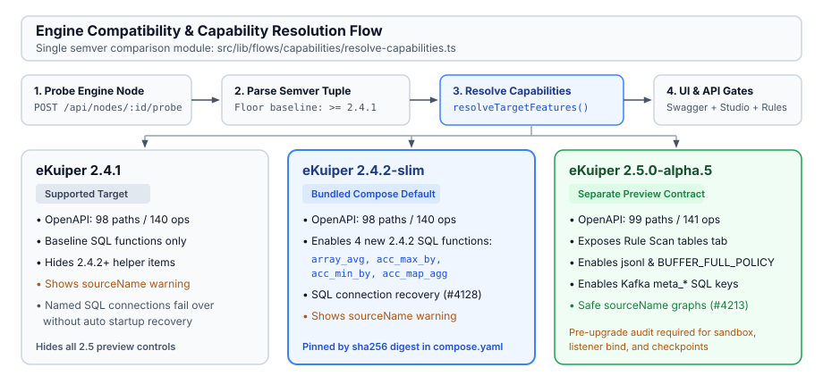
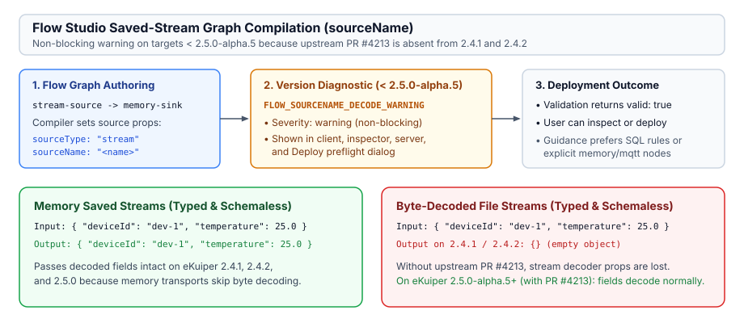

# eKuiper Engine Compatibility Guide



This document defines the supported eKuiper versions, API contracts, and UI capability gates in eKuiper Manager.
The text follows the ASD-STE100 simplified English standard.

---

## 1. Supported Engine Versions

Manager supports multiple eKuiper versions through one semver boundary in `src/lib/flows/capabilities/resolve-capabilities.ts`.

| Engine Version | Role | Image / Tag | OpenAPI Contract |
| --- | --- | --- | --- |
| `2.4.1` | Supported minimum baseline | `lfedge/ekuiper:2.4.1` | `public/ekuiper-openapi.json` (98 paths, 140 operations) |
| `2.4.2-slim` | Bundled Compose default | `lfedge/ekuiper:2.4.2-slim` (`sha256:0e43ef0bfa59d112d0df56b94df817adba44f0906129a5a1a7458eaece975d8a`) | `public/ekuiper-openapi.json` (98 paths, 140 operations) |
| `2.5.0-alpha.5` | Separate preview contract | `v2.5.0-alpha.5` | `public/ekuiper-openapi-2.5-preview.json` (99 paths, 141 operations) |

Procedure to detect target capabilities:

1. Manager queries `GET /` when it probes a registered node (`POST /api/nodes/{id}/probe`).
2. `probeNode` stores the reported engine version in PostgreSQL and rejects versions below `2.4.1`.
3. UI and compiler layers call `resolveTargetFeatures(version)` to obtain boolean `TargetFeatureFlags`.
4. Components show or hide version-specific controls without separate version parsers.

---

## 2. OpenAPI Contracts and Swagger Switcher

Manager keeps the GA and preview REST specifications in separate files:

- Canonical GA contract: `public/ekuiper-openapi.json` and `docs-site/ekuiper-openapi.json` (`2.4.2`, identical bytes).
- Preview contract: `public/ekuiper-openapi-2.5-preview.json` (`2.5.0-alpha.5`, adds `GET /rules/{name}/scantables`).

Run the local OpenAPI validators before commits:

```bash
cmp public/ekuiper-openapi.json docs-site/ekuiper-openapi.json
npm run validate:openapi -- --skip-official
npm run validate:openapi -- public/ekuiper-openapi-2.5-preview.json --skip-official
```

When network access to GitHub is available, remove `--skip-official` to compare routes against upstream tags (`v2.4.2` and `v2.5.0-alpha.5`).
Operators can switch between **2.4.2 (GA)** and **2.5.0-alpha.5 (Preview)** inside `/api-docs`.

---

## 3. Named SQL Connection Recovery (`2.4.2`)

Upstream PR `#4128` in eKuiper `2.4.2` fixes automatic recovery for named SQL connections when startup connection initialization fails.

1. Use `/connections` or `POST /api/ekuiper/connections` to create named shared connections (`typ: "sql"`).
2. Read `/connections` to inspect live `status` (`connected` or `failed`) and error messages.
3. Click **Refresh** on `/connections` to confirm status transitions after engine recovery.

Note on container plugins:

- The bundled `lfedge/ekuiper:2.4.2-slim` image and `2.4.1` core image support `/connections` API registration, but they do not include the `sql` runtime sink/source plugin binary.
- Use a full or custom plugin image when rules must execute live SQL database queries or writes.

---

## 4. Flow Studio Saved-Stream Graph Path (`PR #4213`)



When Flow Studio compiles a `stream-source` or `table-source` node, it emits `sourceType` and `sourceName` in graph node properties (`src/lib/flows/compiler/ekuiper/compile-graph.ts`).

Live behavior on `2.4.1` and `2.4.2` (where upstream PR `#4213` is absent):

- **Memory saved streams** (typed and schemaless) pass decoded event fields to downstream operators.
- **Byte-decoded saved streams** (for example `file` saved streams) omit stream decoder configuration and emit empty `{}` objects.
- **Warning diagnostic**: Client validation, Node Inspector, server validation, and the Deploy preflight dialog show a non-blocking `FLOW_SOURCENAME_DECODE_WARNING` on targets below `2.5.0-alpha.5`.
- **Target `2.5.0-alpha.5+`**: The warning clears because PR `#4213` preserves decoder properties on `sourceName` graph nodes.

Operator recommendation for `2.4.1` and `2.4.2` nodes:

- Use SQL rules in Rule Designer or explicit `memory-source` / `mqtt-source` nodes when a flow reads byte-encoded data.

---

## 5. Flow Studio Offline Target Authoring and Live Deployment

Flow Studio separates draft authoring from target deployment:

1. **Authoring with stored target state**: Flow Studio calls `resolveAuthoringCapabilities({ version, status })`. When a target was previously probed and has a recorded version, the palette and node inspectors use that last known version to enable supported nodes and fields. Even when the target state is `OFFLINE`, drafting and canvas editing remain unblocked.
2. **Server-side validation and compilation**: Flow validation (`POST /api/flows/{id}/validate`) and compilation (`POST /api/flows/{id}/compile`) evaluate the graph against the target's recorded version instead of failing on stored `OFFLINE` status.
3. **Live reachability on deployment**: When the operator clicks **Deploy** (`deployFlow`), Manager checks if the target status is `ONLINE`. If the stored status is not `ONLINE`, Manager executes an immediate live probe (`probeNode`). If the node responds, its capabilities update and deployment proceeds. If the node is unreachable, deployment halts with a clear `NODE_UNREACHABLE` error before creating attempts.

---

## 6. Rule Designer and Workspace Feature Gates

### 6.1 Version `2.4.2+` SQL Functions (`supportsSqlFunctions242`)

Rule Designer (`/rules/new` and `/rules/{id}/edit`) filters the SQL function helper catalog with `getFunctionsForVersion(active?.version, query)`:

- `array_avg(arr)`
- `acc_max_by(value, compare_value)`
- `acc_min_by(value, compare_value)`
- `acc_map_agg(key, value)`

These four functions stay hidden when the active node runs `2.4.1`.
Rule Designer deduplicates `changed_cols` across categories in its UI function list.

When an operator clicks a function in SQL mode, Manager inserts the signature using `insertFunctionIntoSql`:
- If a text selection or caret exists, the function inserts at the cursor position.
- If no selection exists, Manager safely inserts the function into the `SELECT` list (replacing a lone `*` or appending before `FROM`), preventing broken queries. The SQL scanner limits escape handling to string literals (`\'`, `\"`, `''`), leaves backtick identifier backslashes verbatim, and skips single-line (`--`) and multi-line (`/* */`) comments when finding `SELECT` and `FROM`.

### 6.2 Post-`2.4.2` Named Sink Actions (`PR #4235`)

Upstream PR `#4235` on `master-2.4` introduces optional names on sink actions so rules can distinguish two actions of the same connector type.

Caution when named actions are enabled on future `2.4.x` / `2.5+` engines:

- Renaming a sink action changes the engine metric keys and persistent-state identifiers for that sink.
- Always inspect topology and metrics after changing a sink name.

### 6.3 Preview `2.5.0` Feature Floors

Manager gates each preview feature to the exact first release that introduced it:

| Feature Gate | Upstream PR / Release | First Supported Tag | Surface in Manager |
| --- | --- | --- | --- |
| `supportsScanTables` | Upstream route registration | `v2.5.0-alpha.1` | **Scan tables** tab on `/rules/{id}` calling `GET /rules/{name}/scantables` |
| `supportsStreamBufferPolicy` | PR `#4133` | `v2.5.0-alpha.2` | `BUFFER_FULL_POLICY` (`block` or `dropOldest`) in Stream Visual Editor |
| `safeSourceNameGraphs` | PR `#4213` | `v2.5.0-alpha.5` | Clears `FLOW_SOURCENAME_DECODE_WARNING` in Flow Studio |
| `supportsJsonl` | PR `#4218` | `v2.5.0-alpha.5` | `jsonl` stream format option in Stream Visual Editor and `SinkBaseForm` |
| `supportsKafkaRecordMetadata` | PR `#4214` | `v2.5.0-alpha.5` | Kafka `meta_topic` .. `meta_headers` suggestions in Rule Designer |

---

## 7. Pre-Upgrade Verification Checklist for Defaulting `2.5`

Do not change `compose.yaml` to bundle an eKuiper `2.5` image until all three checks pass in live Compose testing:

1. **Listener and RPC access (`#4244`)**: Test Manager-to-engine REST requests across the Compose network under new loopback bind defaults and `basic.disableRpc` settings.
2. **External file access sandbox (`#4144`)**: Test file upload, playback, and SQL/sink file paths under the new `allowExternalFileAccess` default (`false`).
3. **Checkpoint upgrade and rollback (`#4195`)**: Test checkpoint persistence and pre-upgrade backup restore, because `2.5` introduces versioned checkpoints that older `2.4.x` binaries cannot downgrade cleanly.

